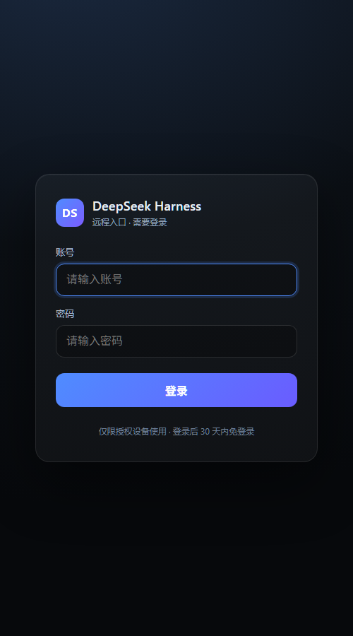

# dsh-remote

把运行在自己电脑上的 **DeepSeek Harness（DSH）桌面端** 安全地开放给手机或其他电脑的浏览器。

手机 → `https://dsh.example.com`（VPS 上的 nginx + 登录页）→ SSH 反向隧道 → 你的电脑上的 DSH 桌面端。

* 电脑**不开放任何入站端口**：隧道由电脑主动 `ssh -R` 连出。
* 公网只暴露 VPS 的 443；回环上的 `127.0.0.1:9100` 由隧道建立。
* 浏览器先通过自定义登录页（账号 + 密码），登录页再下发 DSH 自己签名的 30 天 cookie。
* DSH 的 Host/Origin 防护通过 profile patch 的 `trustedHosts` 放行你的域名，**热加载，不需要重启 DSH**。

> 非 DeepSeek 官方项目。认证 cookie 的格式是从 DSH 桌面端 bundle 中分析出来的，DSH 升级后可能变化，见[兼容性](#兼容性)。



## 目录

- [架构与认证流程](#架构与认证流程)
- [前置条件](#前置条件)
- [快速开始](#快速开始)
  - [1. 准备域名和证书](#1-准备域名和证书)
  - [2. 在 VPS 上安装 relay](#2-在-vps-上安装-relay)
  - [3. 在 Windows 电脑上安装 host](#3-在-windows-电脑上安装-host)
  - [4. 授权隧道公钥并推送 cookie](#4-授权隧道公钥并推送-cookie)
  - [5. 验证](#5-验证)
- [日常维护](#日常维护)
- [macOS](#macos)
- [安全模型与局限](#安全模型与局限)
- [故障排查](#故障排查)
- [兼容性](#兼容性)
- [文件说明](#文件说明)
- [License](#license)

## 架构与认证流程

```
手机浏览器
   │  https://dsh.example.com
   ▼
VPS · nginx / OpenResty
   ├─ GET /            没有 cookie → 302 /login（仅 text/html 导航）
   ├─ GET /login       自定义登录页（HTML 表单）
   ├─ POST /login      校验账号密码 → Set-Cookie（DSH 签名 cookie）→ 302 /
   ├─ /api、WS         无/错 cookie → 401（不跳登录页）
   │  127.0.0.1:9100   ← SSH 反向隧道，仅回环
   ▼
你的电脑 · DSH desktop host
   └─ 127.0.0.1:<随机端口>  每次启动端口都会变，由 watchdog 自动发现并重连
```

认证链路的关键点：

1. **DSH 桌面端**只监听 `127.0.0.1` 的随机端口，本身不暴露公网。
2. 电脑上的 `tunnel.ps1` / `tunnel.sh` 用 SSH 连到 VPS，建立
   `VPS 127.0.0.1:9100 → 电脑 127.0.0.1:<dsh-port>` 的反向隧道。
3. VPS 的 nginx 把 `/` 反代到 `127.0.0.1:9100`，并把 `Host` 设为你的域名。
4. nginx 的 `/login` 用 Lua 校验账号密码，通过后下发一个 **DSH 签名的 cookie**：

   ```
   name  = "dsh-auth-" + base64url(sha256(<Host 头>))
   value = "v1." + base64url(JSON{version,authority,issuedAt,expiresAt})
                 + "." + base64url(HMAC-SHA256(secret, body))
   ```

   `secret` 来自电脑上的 `~/.dsh/.credentials.yaml` 中
   `client-connection/browser-session` 记录；`authority` 是 Host 头（不带 scheme）。
5. 之后的请求由 DSH 自己校验 cookie；cookie 被 DSH 限制为 **最长 30 天**，
   所以需要定时在电脑上重新生成并推到 relay，否则过期后会登录循环。

## 前置条件

* 一台运行 **DSH 桌面端** 的电脑（Windows 与 macOS 均已验证）。
  桌面端需要先启动过一次，以生成 `~/.dsh/.credentials.yaml` 和 desktop profile。
* 一台有公网 IP 的 Linux VPS，已安装 **nginx 或 OpenResty（需要 ngx_lua）**。
  Docker 化的 1Panel/OpenResty 也可以。
* 一个域名 + TLS 证书（Let's Encrypt 或 1Panel 申请均可）。
* 电脑上有 SSH 客户端（Windows 10/11 自带 OpenSSH Client）。

## 快速开始

以下用 `dsh.example.com` / `relay.example.com` 举例，替换成你自己的。

### 1. 准备域名和证书

把 `dsh.example.com` 的 A 记录指向 VPS，并签发证书。最终需要两个 nginx 能读到的路径：

```
/etc/letsencrypt/live/dsh.example.com/fullchain.pem
/etc/letsencrypt/live/dsh.example.com/privkey.pem
```

1Panel 的证书一般在 `/www/sites/<domain>/ssl/` 下，路径以实际为准（若 nginx 在容器里，
要用 **容器内可见** 的路径）。

### 2. 在 VPS 上安装 relay

```bash
git clone https://github.com/wangpi26/dsh-remote.git
cd dsh-remote/relay

# 2.1 自定义登录页 + vhost + cookie include
sudo bash install-relay.sh \
  --domain dsh.example.com \
  --cert /etc/letsencrypt/live/dsh.example.com/fullchain.pem \
  --key  /etc/letsencrypt/live/dsh.example.com/privkey.pem

# 2.2 受限 SSH 用户（拿到电脑的公钥后再执行，见第 4 步）
sudo bash setup-tunnel-user.sh --user dsh-tunnel --port 9100 \
  --pubkey-file /tmp/id_ed25519_dsh_remote.pub
```

脚本会输出登录账号和随机密码，**保存到密码管理器**。它还会：

* 备份已存在的 vhost 到 `<domain>.conf.bak-<时间>`；
* 先 `nginx -t`，失败时自动回滚，不会把坏配置留在线上；
* 不会覆盖已有的 `dsh-cookie.inc`（第一次会放占位内容，登录页此时返回 500）。

**1Panel / Docker 化 OpenResty**（容器名用 `docker ps` 查）：

```bash
sudo bash install-relay.sh \
  --domain dsh.example.com \
  --cert /www/sites/dsh.example.com/ssl/fullchain.pem \
  --key  /www/sites/dsh.example.com/ssl/privkey.pem \
  --conf-dir /opt/1panel/apps/openresty/openresty/conf/conf.d \
  --container 1Panel-openresty-xxxx \
  --container-conf-dir /usr/local/openresty/nginx/conf/conf.d
```

> 1Panel 在站点设置变化时可能重写 vhost。若登录页突然 404，重新跑一次
> `install-relay.sh` 即可（备份和热重载都在脚本里）。

### 3. 在 Windows 电脑上安装 host

在**管理员 PowerShell**中：

```powershell
git clone https://github.com/wangpi26/dsh-remote.git
cd dsh-remote\host\windows

.\install-windows.ps1 `
  -Domain dsh.example.com `
  -RelayHost relay.example.com `
  -RelayUser dsh-tunnel `
  -CookieRelayUser root `
  -SkipCookiePush
```

它做四件事：

1. 往 `%USERPROFILE%\.dsh\profiles\desktop\cordis.patch.yml` 追加
   `trustedHosts: [dsh.example.com]`（**热加载，不重启 DSH**，并自动备份原文件）；
2. 生成专用 SSH key `%LOCALAPPDATA%\dsh-remote\id_ed25519_dsh_remote`；
3. 用 DSH 的签名 secret 生成 `dsh-cookie.inc`；
4. 注册两个计划任务：
   * `dsh-remote-tunnel`：登录时启动隧道 watchdog；
   * `dsh-remote-refresh`：每天 04:00 重新生成并推送 cookie。

`-SkipCookiePush` 是因为此时 relay 上的管理员公钥可能还没配好；先拿脚本打印的公钥去
relay 执行 `setup-tunnel-user.sh`。

如果 relay 用 root 默认密钥，也可以不加 `-SkipCookiePush` 直接推 cookie。

**手动分步**（等价命令）：

```powershell
# 手动分步：只生成 cookie include（install-windows.ps1 已包含这一步）
.\mint-cookie.ps1 -Authority dsh.example.com -WriteInc "$env:LOCALAPPDATA\dsh-remote\dsh-cookie.inc"

# 生成 cookie 并本地验证（200 才算成功；DSH 端口用 Get-NetTCPConnection 查）
.\mint-cookie.ps1 -Authority dsh.example.com -VerifyUrl http://127.0.0.1:<port>

# 推 cookie 到 relay（可用计划任务每天跑）
.\refresh-cookie.ps1 -Authority dsh.example.com -RelayHost relay.example.com `
  -RelayUser root -IdentityFile "$env:LOCALAPPDATA\dsh-remote\id_ed25519_dsh_admin"

# 手动启动隧道（调试用）
.\tunnel.ps1 -RelayHost relay.example.com -RelayUser dsh-tunnel `
  -IdentityFile "$env:LOCALAPPDATA\dsh-remote\id_ed25519_dsh_remote"
```

### 4. 授权隧道公钥并推送 cookie

```bash
# 在 relay 上，公钥内容就是 install-windows.ps1 打印的那行
sudo bash setup-tunnel-user.sh --user dsh-tunnel --port 9100 \
  --pubkey-file /tmp/id_ed25519_dsh_remote.pub
```

然后在 Windows 上推一次 cookie（需要能写 nginx 配置的 admin 身份，通常是 root）：

```powershell
cd D:\path\to\dsh-remote\host\windows
.\refresh-cookie.ps1 -Authority dsh.example.com -RelayHost relay.example.com `
  -RelayUser root -IdentityFile "$env:USERPROFILE\.ssh\id_ed25519_dsh_admin"
```

脚本会：生成新 cookie → `scp` 到 `/tmp` → `install -m 600` 到
`/etc/nginx/conf.d/dsh-cookie.inc` → `nginx -t` → `nginx -s reload`；
测试失败会自动恢复旧文件。

**Docker 化 nginx** 加 `-NginxContainer 1Panel-openresty-xxxx`，
并把 `-RemoteIncPath` 指到宿主机上被挂载进容器的 `conf.d` 路径，例如
`/opt/1panel/apps/openresty/openresty/conf/conf.d/dsh-cookie.inc`。

计划任务里的 `dsh-remote-refresh` 会在每天 04:00 做同样的事（默认 root 用户、
默认密钥）；如果你想用单独的 admin key，需要修改 `run-refresh.cmd`。

### 5. 验证

```bash
# relay 上：隧道已建立
ss -ltnp | grep 9100          # 应看到 127.0.0.1:9100

# 本机（relay 上）：
curl -I -H 'Host: dsh.example.com' http://127.0.0.1:9100/
```

浏览器打开 `https://dsh.example.com/`：

1. 应 302 到 `/login`；
2. 输入账号密码后 302 回 `/`，并带 `Set-Cookie`（HttpOnly / Secure / SameSite=Strict）；
3. 进入 DSH 应用，API 和 WebSocket 正常。

## 日常维护

| 事项 | 做法 |
| --- | --- |
| cookie 续期 | `dsh-remote-refresh` 每天 04:00 自动跑；日志 `%LOCALAPPDATA%\dsh-remote\refresh-cookie.log` |
| 隧道守护 | `dsh-remote-tunnel` 登录自启；日志 `%LOCALAPPDATA%\dsh-remote\tunnel.log` |
| DSH 端口变化 | watchdog 每 15s 重新发现端口并重启隧道，无需人工处理 |
| 换域名/证书 | 重跑 `install-relay.sh`；然后重新 mint cookie（authority 变了）并推送 |
| 改登录密码 | 重跑 `install-relay.sh --password '<新密码>'`（会重新渲染同一 vhost） |
| 轮换隧道 key | 删除电脑上的 key 并重新生成，再在 relay 的 `authorized_keys` 替换对应行 |
| 检查任务 | `schtasks /Query /TN dsh-remote-tunnel /V /FO LIST` |

> **cookie 过期会表现为"登录成功但页面反复跳登录页"**：登录页确实下发了 cookie，
> 但 DSH 拒绝了过期/签名错误的 cookie，于是 401 → 又跳 `/login`。先看
> `refresh-cookie.log` 是否成功，再手动跑一次 `refresh-cookie.ps1`。

## macOS

macOS 的脚本在 [`host/macos/`](host/macos/)，与 Windows 设计一致：

* `mint-cookie.py`：跨平台，读 `~/.dsh/.credentials.yaml` 生成 cookie（**已验证**）；
* `tunnel.sh`：自动发现 DSH 端口并保持隧道；
* `install-macos.sh`：合并 trustedHosts、生成 key、mint cookie、安装 launchd；
* `refresh-cookie.sh`：推 cookie + `nginx -t` + reload，可挂 launchd/cron。

已在 macOS（Apple silicon）上用真实 DSH 桌面端验证：cookie 本机 200、错误 authority 401；
`tunnel.sh` 自动发现端口并在 relay 上建立 `127.0.0.1:9101`；launchd 加载、`launchctl print`
running、kill 后 KeepAlive 拉起；trustedHosts 幂等且**热加载**（不重启 DSH 生效）；
`refresh-cookie.sh` 的暂存上传 + `install -m 600` + `nginx -t` 路径。

macOS 与 Windows 行为不同的地方（脚本已处理，细节见
[`host/macos/README.md`](host/macos/README.md)）：

* **`pgrep -f dsh-desktop-host` 在 macOS 上看不到 DSH 宿主进程**——它是 Electron 的子进程，
  `pgrep` 读不到它的 argv（只有 Helper 进程能匹配），但 `ps -axo pid=,args=` 读得到。
  `tunnel.sh` 因此先用 `ps`、再退回 `pgrep`/`lsof`。
* 监听地址可能是 `127.0.0.1`，也可能是 IPv6-only 的 `[::1]`；隧道转发目标跟随实际绑定。
* launchd 的默认 PATH 只有 `/usr/bin:/bin:/usr/sbin:/sbin`，`bash`/`ssh`/`lsof`/`ps` 都在其中，
  不需要额外声明 PATH。
* `ssh` 会把 argv 用空格拼接、由远端 shell 重新切分，所以 `refresh-cookie.sh` 不再把
  `"docker exec … nginx -t"` 当整串参数传递（旧写法会退化成 `eval docker`：打印帮助却返回 0，
  形成"假成功"）。nginx 跑在 Docker 里时用 `--container <容器名>`。

## 安全模型与局限

**做了什么**

* 公网只开放 443；DSH 的端口和隧道端点都在回环地址上。
* 浏览器必须先在自定义登录页通过账号密码，才能拿到 DSH 签名的 cookie；
  cookie 是 HttpOnly + Secure + SameSite=Strict。
* 登录页带 CSP、`X-Frame-Options: DENY`、`Cache-Control: no-store`。
* DSH 的 Host/Origin 防护只放行你的域名（`trustedHosts`），其他 Host 继续 403。
* 隧道 key 在 relay 上被限制为
  `restrict,port-forwarding,permitlisten="127.0.0.1:9100"`：
  只能建这一个回环转发，不能登录 shell、不能 scp、不能转发其他端口。
* 推送 cookie 建议用单独的 admin key，与隧道 key 分离。
* cookie 文件在 relay 上是 `600`，且脚本永不打印 cookie 值（只打印长度/路径）。

**局限**

* 单账号，没有用户管理/登出/会话列表。要撤销某个浏览器的会话，只能轮换 DSH 的
  browser-session secret（需要重启 DSH）或等 cookie 过期。
* Lua 里存的是 `MD5(salt + password)`，属于"门锁"级别，不是密码数据库；
  请用长随机密码（安装脚本会生成 18 位）。
* 登录页没有内置限速。公网暴露时建议在 nginx 增加 `limit_req`，或只允许自己的
  IP 段访问 `/login`。
* DSH 桌面端必须保持运行；电脑睡眠/关机时 relay 会 502。
* 电脑重启后 DSH 端口会变，watchdog 会在 15 秒内自动重连。
* 本项目依赖 DSH 未公开的 cookie 实现，**DSH 升级可能使其失效**。

## 故障排查

### 502 Bad Gateway

隧道没建立，或 relay 上的 9100 没有监听。

```bash
# relay
ss -ltnp | grep 9100
# 电脑
Get-Content "$env:LOCALAPPDATA\dsh-remote\tunnel.log" -Tail 20
```

常见原因：电脑没登录/睡眠、SSH key 未授权、DSH 没启动、`permitlisten` 端口不匹配。

### 403 Forbidden

DSH 的 Host/Origin 防护拒绝了请求，通常是 `trustedHosts` 没生效：

```powershell
Get-Content "$env:USERPROFILE\.dsh\profiles\desktop\cordis.patch.yml" -Tail 10
```

确认里面有你的域名且 YAML 缩进正确。patch 是热加载的；若仍 403，看 DSH 日志。

### 登录成功但反复跳回登录页

cookie 过期或 authority 不匹配。手动验证：

```powershell
# 先查 DSH 本地端口
Get-NetTCPConnection -State Listen | Where-Object { $_.LocalAddress -eq '127.0.0.1' }

.\mint-cookie.ps1 -Authority dsh.example.com -VerifyUrl http://127.0.0.1:<port>
```

`-VerifyUrl` 返回非 200 时，检查：

* `-Authority` 必须和 nginx 传给 DSH 的 Host 完全一致（域名，不带 `https://`）；
* 如果用了非 443 端口，authority 要带端口（`host:port`）；
* `~/.dsh/.credentials.yaml` 是否属于当前 DSH profile。

### `/login` 返回 500

`dsh-cookie.inc` 还是占位内容（`set $dsh_cookie "";`），从电脑推一次 cookie。

### `/login` 返回 404 或落到 DSH 页面

vhost 被覆盖或没生效。检查 `conf.d/<domain>.conf` 里是否有 `location = /login`，
必要时重跑 `install-relay.sh`（会先备份再 `nginx -t`）。

### `nginx -t` 失败

脚本会自动回滚并报错。手动恢复：

```bash
ls /etc/nginx/conf.d/*.bak-*
cp -a /etc/nginx/conf.d/<domain>.conf.bak-<时间> /etc/nginx/conf.d/<domain>.conf
nginx -t && nginx -s reload
```

### 计划任务没跑

* 任务以**登录用户**身份运行，电脑必须处于登录状态（桌面端也要运行）；
* `schtasks /Query /TN dsh-remote-tunnel /V /FO LIST` 看上次结果；
* 日志：`tunnel.log`、`tunnel-ssh.err.log`、`refresh-cookie.log`。

## 兼容性

* 认证 cookie 的算法来自 DSH 桌面端的 `@deepseek-ai/dsh-client-connection`
  实现：`dsh-auth-<sha256(authority)>` + `v1.<payload>.<hmac>`，secret 存在
  `~/.dsh/.credentials.yaml` 的 `client-connection/browser-session` grant 记录里。
* 实测环境：Windows 11 + DSH 桌面端（2026-10 版本）+ OpenResty 1.21（1Panel Docker）。
* 判断是否仍兼容的最快方法：

  ```powershell
  .\mint-cookie.ps1 -Authority dsh.example.com -VerifyUrl http://127.0.0.1:<port>
  # 返回 200 = 算法仍匹配；401 = DSH 改了 cookie 校验
  ```

* 若 DSH 改动：以 `@deepseek-ai/dsh-client-connection/lib/index.js` 为准重新核对
  `encodeCookie` / `decodeCookie` / `cookieName` / `requestAudience`。
* `cookieMaxAgeDays` 默认 30，mint 脚本只允许 1–30 天（DSH 会校验
  `expiresAt - issuedAt <= maxAgeDays`）。

## 文件说明

| 路径 | 作用 |
| --- | --- |
| `relay/install-relay.sh` | 渲染 vhost + 登录页 + cookie include，备份、`nginx -t`、reload/回滚 |
| `relay/nginx/dsh-site.conf.template` | nginx vhost 模板（80→443、/login、401→登录页、长连接反代） |
| `relay/nginx/dsh-login.lua.template` | 登录页 + 账号密码校验 + 下发 cookie |
| `relay/dsh-cookie.inc.template` | cookie include 占位 |
| `relay/setup-tunnel-user.sh` | 创建受限 SSH 隧道用户（`restrict,permitlisten`） |
| `host/windows/install-windows.ps1` | Windows 一键安装（patch、key、cookie、计划任务） |
| `host/windows/tunnel.ps1` | 端口发现 + 反向隧道 watchdog（断线/换端口自动重连） |
| `host/windows/mint-cookie.ps1` | 从本地 DSH 凭据生成 cookie include，可本地 200 验证 |
| `host/windows/refresh-cookie.ps1` | 生成 + 上传 + `nginx -t` + reload（失败回滚） |
| `host/macos/*` | macOS 实现（cookie 生成脚本跨平台；host 路径已在 macOS 实测） |
| `docs/login-page.png` | 登录页截图 |

## License

MIT，见 [LICENSE](LICENSE)。
